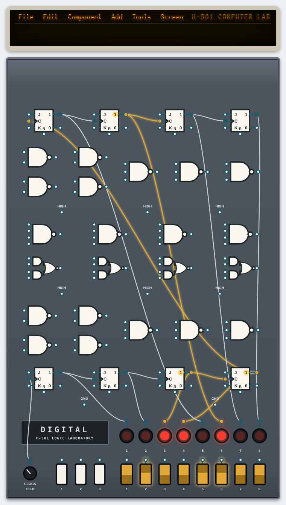

# H-501 Computer Lab

A browser recreation of DEC's H-500 Computer Lab, the patch-cord logic trainer
of the late 1960s, and one step beyond it. Wire NAND gates, AND/NOR gates and
J-K flip-flops together, flip the switches, press the pulsers, run the clock and
watch the lamps.

**[Try it in your browser](https://brentlavelle.github.io/DEC-H501/)**. Nothing
to install.



## Dedication

To my father. He worked for Digital Field Service in the 1970s. I remember when
he brought an H-500 home so I could learn logic on it. He taught me truth
tables, digital circuits, and math in general. This project is for you dad.

## What it is

The H-500 was a teaching panel: eight J-K flip-flops, a field of NAND and
AND/NOR gates, eight switches, three pulsers, eight lamps and a variable clock,
all wired together with patch cords. Students built counters, shift registers
and adders on it from a workbook.

This project puts that panel in a browser, laid out the way the real one was,
with a simulator that behaves the way the real parts did. It also goes a little
further, which is why it is called the H-501: a free-form editor, extra gate
types, reusable components built from your own circuits, and a parts list in
real 7400-series chips.

## Run it

The live version is at
[brentlavelle.github.io/DEC-H501](https://brentlavelle.github.io/DEC-H501/). It
is served by GitHub Pages straight from `main`, so it is always the latest.

To run your own copy there is nothing to install and nothing to build. Serve the
folder with any static web server and open it in a browser:

```bash
python3 -m http.server
# then open http://localhost:8000
```

Opening `index.html` straight from disk does not work: the page loads JavaScript
modules and reads the panel layout from a file, and browsers block both for
local files.

## Using it

- **Wire two parts:** Press on an output terminal, drag to an input terminal and
  let go. A filled terminal has a wire on it; an open ring has nothing
  connected.
- **Flip a switch:** Click it. A switch that is on glows.
- **Pulse a pulser:** Press and hold. It is HI while held and glows.
- **Set the clock:** Click the knob to step through off, 0.25, 0.5, 1 and 10 Hz.
  The rate is shown under it.
- **Add a part:** Pick it from the **Add** menu.
- **Select:** Click a part. Shift-click to add more, or drag a box on empty
  board.
- **Move:** Select, then right-drag (or Ctrl-drag) the selection. **Edit → Snap
  to grid** lines parts up.
- **Delete:** Select a wire or parts and press Delete or Backspace, or use
  **Edit → Delete Selected**.
- **Undo and redo:** Ctrl-Z and Ctrl-Shift-Z (Cmd on a Mac), or the **Edit**
  menu.
- **Build a component:** Select some parts, then **Component → Make Component
  from Selection**. The parts become one box. Double-click the box to edit
  inside it; the line under the menus is the way back out.
- **Start over or open an example:** **File → New H-501** gives a fresh panel,
  **File → New empty board** a blank one, and **File → Examples** opens a
  ready-built circuit: an 8-bit binary counter, or one of two experiments from
  the 1969 workbook, the 4-bit shift register (3.5) and the parity bit
  generator (2.7).
- **Save and load:** **File → Save** and **File → Load...** use plain JSON
  files.
- **Get a parts list:** **Tools → Generate BOM** lists the 7400-series chips
  your circuit would need.
- **Change the screen:** **Screen** switches the terminal between amber, green
  and white phosphor.

An input with nothing connected reads HI, as it does on real TTL. The flip-flops
change on the trailing edge of the clock, and their reset is active LO, as on
the original.

## Parts

From the H-500: J-K flip-flops, 2-, 3- and 4-input NAND gates, AND/NOR gates,
switches, pulsers, lamps, the clock, and HIGH and GND terminals. Also available:
AND, OR, NOT, NAND, NOR, XOR and XNOR.

How the simulation differs from the hardware, and why, is written down in
[section 7 of the parity
specification](docs/H500-PARITY.md#7-deliberate-differences-from-the-hardware).

## How it is built

Plain JavaScript modules and SVG. No framework, no dependencies, no build step.

- `sim/` is the simulator. It never touches the page or the system clock; time
  is passed in, which is what makes it testable.
- `renderer.js` draws the board, `boardEditor.js` handles everything you do to
  it, and `editing.js` holds the editing rules as plain functions.
- `panels/h500.json` is the starting layout. `gates.svg` holds the part symbols.
- `docs/H500-PARITY.md` defines what "behaves like an H-500" means. The tests
  are written against it.

Run the tests with Node 20 or later. Nothing needs installing:

```bash
node --test
```

Much of this project was built with AI coding agents. `AGENTS.md` is the brief
they work from and `docs/WORK-PACKAGES.md` is the plan; both are kept current,
and they are the best place to start if you want to contribute, with or without
an agent.

## Sources

- [Digital Computer Lab Workbook, 1969](https://cdn.hackaday.io/files/1702327283205888/Digital_Computer_Lab_Workbook_1969.pdf)
- [Specifications, transcribed](https://mail.smecc.org/logic_trainers_%26_simple_computers.htm)
- [DEC H-500 Computer Lab reproduction, project logs](https://hackaday.io/project/170232-dec-h-500-computer-lab-reproduction)
- [DEC H-500 Computer Lab reproduction, write-up and photographs](https://www.instructables.com/DEC-H-500-Computer-Lab-Reproduction/)
- [Museum catalogue entry, Ingenium](https://collection.ingenium.ca/en/id/1977.0049.001)

The terminal uses [Glass TTY VT220](https://github.com/svofski/glasstty) by
Viacheslav Slavinsky, which is in the public domain.

## Trademarks

DEC, Digital and H-500 are trademarks of HP. They are used here only to identify
the original hardware. This project is not affiliated with or endorsed by HP.
H-501 is this project's own name; DEC made no H-501.

## License

Apache License 2.0. See [LICENSE](LICENSE) and [NOTICE](NOTICE).
