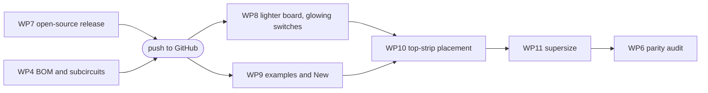

# Work packages

Each package is sized for one agent session on one branch. Cut the branch from `main`, name it
`wp<N>-<slug>`, and merge it into `main` with `git merge --no-ff` only after its acceptance
list passes.

## Status, 2026-11-19

| Package | State |
|---------|-------|
| WP0 one trunk | Done |
| WP1 simulator core | Done |
| WP2 editor on the simulator | Done |
| WP3 missing H-500 parts | Done. Undo and redo, and a clock off position, landed with it |
| WP5 H-500 layout | Closed. The preset, board size from `circuit.board`, labels, the panel look and the nameplate landed. Its open items moved: free-spot placement to WP10, "New" offering the preset to WP9, the board size control to WP11 |
| WP7 open-source release | Next |
| WP4 BOM and subcircuits | Open |
| WP8 lighter board, glowing switches | Open |
| WP9 examples and New | Open |
| WP10 parts land in the top strip | Open |
| WP11 supersize | Open, one design question below |
| WP6 parity audit | Open, last |

The text of the finished packages is in git history (`git show 751d8be:docs/WORK-PACKAGES.md`).

## Order



WP7 comes first because nothing can be published without it. WP4 fixes the one wrong number
a visitor will see (the BOM) and is fully gated by tests, so it goes in before the push.
WP8 and WP9 touch different files and can run at the same time. WP10 goes before WP11 because
the doubled top strip is the first real test of the free-spot search.

## Prompts

**Worker.** Replace `N`.

```text
You are working in the DEC-H501 repository. Read AGENTS.md, then docs/H500-PARITY.md, then
the section "WP N" in docs/WORK-PACKAGES.md. Do WP N and nothing else.

Before you write code, state in five lines or fewer which files you will touch and which
tests you will add. Then proceed without waiting for a reply.

Work on a branch named as AGENTS.md says. Finish with the report format in AGENTS.md. If you
hit one of the stop conditions in AGENTS.md, stop and report instead of guessing.
```

**Reviewer.** Give this to a model from a different vendor than the worker. Replace `N` and
the branch name.

```text
You are reviewing branch wpN-... of the DEC-H501 repository. You did not write it. Read
AGENTS.md, docs/H500-PARITY.md and the section "WP N" in docs/WORK-PACKAGES.md.

Run `node --test`. For every item in the WP N acceptance list, answer pass or fail and give
the evidence: a test name, or a file and line. Then look for these and list what you find:
tests that restate the implementation instead of checking the spec; tests that were skipped,
loosened or deleted; DOM access, timers or wall-clock time under sim/; runtime state written
onto circuit objects; behavior that differs from docs/H500-PARITY.md without being listed in
its section 7.

Do not fix anything. Report.
```

## Which model for which package

| Package | Cost of getting it wrong | Use |
|---------|--------------------------|-----|
| WP7 | Medium. It is the project's public face | Claude Opus 5.5 or Sonnet 5.5. A human reads the README before the push |
| WP4 | Low. Fully gated by tests | A local coding model on the M4 Max is acceptable |
| WP8 | Low. Visual only | Sonnet 5.5, Copilot or Codex |
| WP9 | Low to medium | Sonnet 5.5, Copilot or Codex |
| WP10 | Medium. Pure function, easy to test, easy to get subtly wrong | Sonnet 5.5 or Codex, reviewed by the other |
| WP11 | Medium. Layout and ids | Claude Opus 5.5 or Sonnet 5.5 |
| WP6 | It is the audit | A different vendor from whoever wrote WP1 |

---

## WP 7: open-source release

**Goal.** A repository that can be pushed to a public GitHub repo as it stands: licensed,
explained, and holding only the project, its tests and its docs.

**Do.**

1. Add `LICENSE` with the unmodified Apache License 2.0 text, copyright 2026 Brent LaVelle.
   Add `"license": "Apache-2.0"` to `package.json`. The VT220 font keeps its own licence in
   `fonts/` (the Unlicense, compatible).
2. Rewrite `README.md` for the app as it is now. It still describes the August 2026
   prototype: a side palette, drag to move, "open index.html directly". Cover:
   - What the H-500 was, in two or three sentences, and a screenshot of the board
     (`docs/images/`).
   - Running it: any static server (`python3 -m http.server`). Opening `index.html` from disk
     does not work, because the page loads ES modules and fetches `panels/h500.json`.
   - Using it: the menus, click to select, right-drag or Ctrl-drag to move, drag from an
     output to an input to wire, Delete, undo and redo, the clock knob and its positions, the
     pulsers and switches, Make Component, Generate BOM, the phosphor colours.
   - The parts, and how they differ from the hardware (link to section 7 of the parity spec).
   - Development: no dependencies, no build, `node --test` on Node 20 or later; where the
     simulator, editor and renderer live; `AGENTS.md` and `docs/` for anyone working with AI
     agents.
   - Credits and sources: the workbook, the reproduction project and the museum entry the
     spec cites; Glass TTY VT220 by Viacheslav Slavinsky.
   - A trademark note: DEC, Digital and H-500 are used to identify the original hardware;
     the project is not affiliated with HP, which owns them.
   - The licence.
3. Remove from the tree the files listed under "Files that are not the project" below that
   Brent confirms.
4. Refresh `AGENTS.md`: the repo state paragraph, the module map (add `editing.js`,
   `menus.js`, `simDriver.js`, `sim/`, `panels/`, `fonts/`), the known defects (only the BOM
   one, item 9, is still open; it is WP4), and the "leave these alone" line once the demo
   files are gone.
5. Do not change any `.js`, `.css`, `.svg` or `.json` file. This package is documentation
   and housekeeping.

**Files that are not the project.** Brent decides; the default is the recommendation.

| File | What it is | Recommendation |
|------|------------|----------------|
| `copilot-demo.html`, `qwen3-demo.html` | Gate-symbol studies from a model comparison | Remove |
| `draggable.html` | The 2025 one-gate prototype page | Remove |
| `PLAN.md` | Roadmap for tracks 1 to 4, all landed | Remove |
| `context.md` | A pointer to `AGENTS.md` and a personal note | Remove. Keep the note somewhere private if wanted |
| `.github/agents/dec-h501.agent.md` | Copilot agent definition describing the old code | Remove, or replace with a three-line pointer to `AGENTS.md` |
| `docs/prompts/WP0-local.md` | Step-by-step WP0 for a local model; WP0 is done | Remove |
| `AGENTS.md`, `CLAUDE.md`, `docs/WORK-PACKAGES.md` | How the project is built with agents | Keep; refresh as in item 4 |
| `exampleCircuit.json` | Small version 1 sample, used by two tests | Keep |
| `binary-counter.json` | Untracked; Brent's 8-bit counter | Leave for WP9 |
| `.bak/` | Old scratch files, ignored by git | Not affected; never pushed |

**Acceptance.**

- `node --test` passes.
- `LICENSE` is the Apache License 2.0 text, unmodified apart from the appendix fields.
- From a fresh clone, the README's run instructions open the board, and every control the
  README names does what it says.
- `git ls-files` shows nothing from the removed list, and every remaining file is code,
  tests, fixtures, assets, or a doc that describes the current code.

---

## WP 4: BOM and subcircuits

**Goal.** The two features that are not part of the H-500 are tested and correct against
the new simulator.

**Do.**

1. `icCatalog.js`: add `andnor` as 7450, two gates per package. Change `jk` to 7473, two per
   package, which is the part the H-500 used.
2. `generateBOM`: `switch`, `led`, `pulser`, `clock`, `hi` and `gnd` are not ICs and are not
   counted in `totalGates`.
3. Tests for `makeComponent` and `ungroupComponent`: build a full adder from loose gates,
   record the lamp outputs for all eight input combinations, group it, compare, ungroup it,
   compare. Repeat with a subcircuit placed inside another subcircuit.
4. Test that `makeComponent` rejects a name that is already a type, and that boundary pins
   come out named `in0...` and `out0...` in a stable order.

**Acceptance.**

- BOM of exactly the section 2 inventory (8 `jk`, 8 `2nand`, 6 `3nand`, 4 `4nand`,
  4 `andnor`, plus the switches, pulsers, lamps and clock) is 2 x 7400, 2 x 7410, 2 x 7420,
  2 x 7450, 4 x 7473, with `totalGates` 30. Use the LS part numbers the catalog already uses
  if you keep them, and say so in the report.
- Every test in items 3 and 4 passes.

---

## WP 8: lighter board, glowing switches

**Goal.** The board reads a little lighter, and a switch that is on glows the way a held
pulser already does.

**Do.**

1. Lighten the board's grey faceplate a step (`#board` background in `styles.css`). Check the
   white symbols, the pin dots, energized wires and the lamp glow still stand out.
2. A switch whose output is HI gets the same glow treatment as a pressed pulser
   (`#board use[data-type="pulser"][data-state="1"]`). The renderer already sets
   `data-state` on every part, so this should be CSS only.
3. Add one line to section 5 of `docs/H500-PARITY.md`: a switch that is on glows.

**Acceptance.**

- `node --test` passes. Extend `test/page.test.js`: `styles.css` has a rule for
  `use[data-type="switch"][data-state="1"]`.
- By hand: switches 1 to 8 on and off are told apart at a glance at 1.2x; a lamp that is on
  is still obvious on the lighter board; amber, green and white phosphor all still read.

---

## WP 9: examples and New

**Goal.** Brent's 8-bit binary counter ships as a ready-made example, and New offers a
choice of starting points.

**Do.**

1. Move `binary-counter.json` into `examples/` unchanged. Add `examples/index.json`, a list
   of `{ "file", "title" }`, because a static server cannot list a folder.
2. File menu: "New H-500" (the preset, as at start-up), "New empty board", and one item per
   example. Each asks for confirmation as New does now, and each can be undone.
3. An empty board takes the H-500's size, 600 x 970, so the terminal and board line up as
   they do on the preset. Today it is 1200 x 800.
4. Start-up still loads the blank H-500.

**Acceptance.**

- Test: every file in `examples/index.json` exists, validates, flattens and builds a
  simulator.
- Test: the binary counter counts. After N clock periods at its saved rate the lamps read N
  in binary, lamp 1 the least significant bit, for N = 1, 2, 3, 8 and 255, and wrap at 256.
- `test/page.test.js` still passes with the new menu items.
- By hand: each New item gives what it says, and Undo returns the previous circuit.

---

## WP 10: new parts land in the top strip

**Goal.** A part added from the Add menu lands in the empty strip along the top of the
board, in the first space that fits, instead of on top of whatever is at (100, 100).

**Do.**

1. Add `findFreeSpot(view, footprint, board)` to `editing.js`, with no DOM access. It
   scans the strip along the top of the board, 80 units tall, from left to right, and
   returns the first position where the footprint overlaps no part, keeping a small gap
   between parts. When nothing fits it returns the upper-right corner, even if that
   overlaps.
2. The search looks at what is on the board now, so a gap left by a part the user moved is
   reused before anything further right.
3. Footprints come from `getComponentSize`, so subcircuit boxes and 40 x 30 terminals pack
   as well as 84 x 65 gates.
4. Inside a subcircuit definition the same rule applies to that definition's area.
5. The Add menu uses it. The new part stays selected, as now.

**Acceptance.** Tests:

- The first part on the H-500 lands at the left of the strip; the next lands to its right.
- Moving a part out of the strip opens a gap, and the next part of a size that fits goes
  into that gap, not after the last part.
- A full strip sends the next part to the upper-right corner.
- A mix of gates, terminals and a subcircuit box never overlaps.
- The function does not modify its arguments.

By hand: add ten parts to the H-500, move one out of the strip, add one more, and see it
fill the gap.

---

## WP 11: supersize

**Goal.** One menu action turns the board into two H-500 units side by side, for circuits
that need more than one panel's worth of parts.

**Do.**

1. Edit menu: "Supersize: add a second unit". It doubles the board width to 1200 units and
   adds a fresh copy of the H-500 inventory, taken from `panels/h500.json` rather than from
   whatever the user has moved, in the new right-hand half.
2. The copy leaves out the nameplate and the clock. One clock and one nameplate serve the
   whole machine.
3. New parts continue the numbering: flip-flops 9 to 16, lamps and switches labelled 9 to
   16, pulsers 4 to 6. Ids follow the preset's pattern and must not collide.
4. The bottom row of the new half: three pulsers, the slightly larger gap, eight switches,
   with each lamp over its switch. **Open question for Brent:** copy it straight across
   (aligned under the logic above, leaving the clock's spot empty at the start of the row),
   or slide it left into that spot so the row starts at the seam.
5. Existing parts and wires do not move. No wires are copied. The action can be undone.
   It is offered only while the board is one unit wide.
6. The top strip now runs across both halves; WP10's search uses all of it.
7. Put the rule in a function with no DOM access, for example `supersize(circuit)`.
8. Record the second unit in section 6 of `docs/H500-PARITY.md` as a deliberate departure
   from the hardware, in the same section as the other departures.

**Acceptance.** Tests:

- Counts double except the clock and the nameplate, which stay at one.
- Every part lies on the 1200-wide board, no two overlap, and each new lamp is over its
  switch.
- Labels and ids are as in item 3, and every id is unique.
- The original parts and wires are unchanged, and the result builds a simulator.
- Calling it a second time is refused.

By hand: supersize the binary counter, wire switch 9 to lamp 9, and see both halves work
from the one clock; the terminal and board widen together.

---

## WP 6: parity audit

**Goal.** An independent answer to "is this at parity", with evidence.

**Do.**

1. Go through sections 2, 3 and 6 of the parity spec line by line. For each line give pass
   or fail and the evidence.
2. Check the two facts the spec could not read directly, the J-K truth table and the
   AND/NOR expression, against the workbook's chapter 4 and chapter 5 figures. Check every
   **[W]** page reference you can.
3. Build five workbook experiments as fixtures with tests, taking the wiring from the
   workbook figures: 1.1 (2-input NAND), 1.4 (inverter), 3.1 (R-S flip-flop), one counter
   and one shift register.
4. Write `docs/PARITY-AUDIT.md`: the table from step 1, the result of step 2, the
   experiments from step 3, and every difference from the hardware that section 7 of the
   spec does not already list.

**Acceptance.** `docs/PARITY-AUDIT.md` exists, `node --test` passes, and every failure in
the audit has either a fix merged or a line added to section 7 of the parity spec.

---

## After parity

Not part of this plan: autosave, netlist export, fan-out warnings, transcribing the rest of
the workbook.
